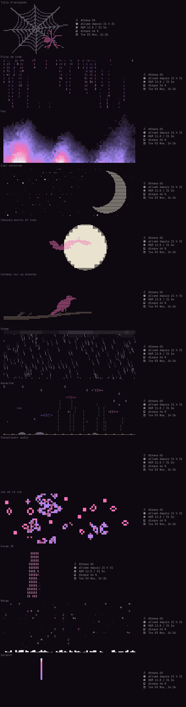

# forsaken-rice

[Français](README.md) · **English** · [Русский](README.ru.md) · [Español](README.es.md)

A Hyprland desktop you set up entirely from one app, **Studio**: colors, windows, bar, wallpaper, displays, sound, keyboard, shortcuts, sleep, bots… Everything applies live, and the whole rice is available in **French, English, Russian and Spanish**.



## What's inside

- **Studio** (Super+Shift+C): a GTK4 / libadwaita app that generates the whole config from a single file (`~/.config/studio/studio.json`). 8 ready-made themes, your own colors, or colors taken from the wallpaper.
- **Files** (Super+E): a native GTK4 file manager, themed to match. List or grid view, sidebar, copy/cut/paste, trash, rename, properties, search, and archive compression/extraction (zip, tar.gz, tar.xz…). Full right-click menu, keyboard shortcuts, and sorting by name, size, type, or date.
- **Waybar** in 6 styles, with memory, CPU, GPU, disk, sound, network, clipboard, screenshots, do-not-disturb and bots.
- **Animated kitty terminal**: 13 animations (spider web, code rain, fire, night sky, bats, crow, thunderstorm, aquarium, audio visualizer, Game of Life, 3D Arch logo, snow, snake) in the theme colors.
  - Looping in a panel at the top, only on launch, as a still image, or off.
  - **Random** mode: a different animation in every terminal, among the ones you pick.
  - Settings for each animation, plus speed, size, smoothness, and system info of your choice next to it.
- **Starship prompt** on two lines, in the theme colors.
- **Wofi menus**: session, clipboard, bots, close a memory-hungry app.
- **Language**: one setting changes every text on the desktop.

## Install

For Arch Linux and derivatives, with **Hyprland 0.57 or newer** (Lua configuration).

```bash
git clone https://github.com/dontleteuwatchyou/forsaken-rice
cd forsaken-rice
./install.sh --lang en
```

The script:
1. installs the missing packages with `pacman` (`--no-deps` skips this);
2. backs up your current config to `~/.local/share/rice-backups/`;
3. copies Studio, the scripts and the configs, then generates the theme.

Then log back into Hyprland. The keyboard is AZERTY by default: change it in Studio, “Keyboard and mouse” tab.

## Main shortcuts

| Keys | Action |
|---|---|
| Super + Enter | Terminal |
| Super + D | App launcher |
| Super + Shift + C | Studio |
| Super + E | Files |
| Super + V | Clipboard history |
| Super + Shift + S / Print Screen | Screenshot of an area |
| Super + X | Session menu |
| Super + L | Lock |
| Super + top-row keys 1–5 | Workspaces 1 to 5 of the screen under the mouse |

Every shortcut can be changed in Studio, “Shortcuts” tab.

## Where the files go

| In the repo | Installed to | What it is |
|---|---|---|
| `studio/` | `~/.local/share/studio/` | the Studio app, the file manager, the theme engine, the animations, the translations |
| `bin/` | `~/.local/bin/` | the commands (`studio`, `studio-fichiers`, `studio-apply`, `forsaken-banner`…) |
| `desktop/` | `~/.local/share/applications/` | `.desktop` files (Files shows up in app launchers) |
| `config/hypr/hyprland.lua` | `~/.config/hypr/` | the base Hyprland config (the rest is generated by Studio) |
| `config/kitty/kitty.conf` | `~/.config/kitty/` | includes `studio.conf`, generated by Studio |
| `config/starship.toml` | `~/.config/` | the prompt template |
| `config/zsh/zshrc` | `~/.zshrc` | history, completion, plugins, prompt, animation |

To add an animation: a class in `studio/animations.py` (with its `OPTIONS` list). It shows up in Studio on its own. To add a language or a text: `studio/traductions.py`. To add an archive format: the `ARCHIVE_EXT` constant in `studio/fichiers.py`.
