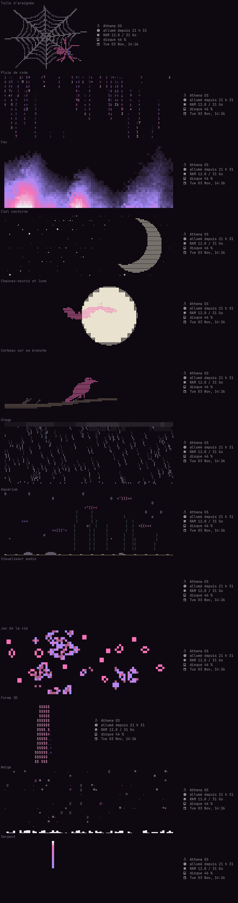

# forsaken-rice

[Français](README.md) · [English](README.en.md) · [Русский](README.ru.md) · **Español**

Un escritorio Hyprland que se configura por completo desde una sola aplicación, **Studio**: colores, ventanas, barra, fondo de pantalla, pantallas, sonido, teclado, atajos, suspensión, bots… Todo se aplica al instante, y todo el rice está disponible en **francés, inglés, ruso y español**.



## Qué incluye

- **Studio** (Super+Mayús+C): una aplicación GTK4 / libadwaita que genera toda la configuración a partir de un único archivo (`~/.config/studio/studio.json`). 8 temas listos, tus propios colores o los del fondo de pantalla.
- **Barra waybar** en 6 estilos, con memoria, procesador, tarjeta gráfica, disco, sonido, red, portapapeles, capturas, «no molestar» y bots.
- **Terminal kitty animado**: 13 animaciones (telaraña, lluvia de código, fuego, cielo nocturno, murciélagos, cuervo, tormenta, acuario, visualizador de audio, juego de la vida, logo de Arch en 3D, nieve, serpiente) con los colores del tema.
  - En bucle en un panel arriba, solo al abrir, como imagen fija o desactivado.
  - Modo **aleatorio**: una animación distinta en cada terminal, entre las que elijas.
  - Ajustes propios de cada animación, además de velocidad, tamaño, fluidez e información del sistema a tu elección al lado.
- **Prompt starship** en dos líneas, con los colores del tema.
- **Menús wofi**: sesión, portapapeles, bots, cerrar una aplicación que consume mucho.
- **Idioma**: un solo ajuste cambia todos los textos del escritorio.

## Instalación

Para Arch Linux y derivadas, con **Hyprland 0.57 o posterior** (configuración en Lua).

```bash
git clone https://github.com/dontleteuwatchyou/forsaken-rice
cd forsaken-rice
./install.sh --lang es
```

El script:
1. instala los paquetes que faltan con `pacman` (`--no-deps` se salta este paso);
2. guarda tu configuración actual en `~/.local/share/rice-backups/`;
3. copia Studio, los scripts y las configuraciones, y luego genera el tema.

Después vuelve a entrar en Hyprland. El teclado es AZERTY por defecto: se cambia en Studio, pestaña «Teclado y ratón».

## Atajos principales

| Teclas | Acción |
|---|---|
| Super + Intro | Terminal |
| Super + D | Lanzador de aplicaciones |
| Super + Mayús + C | Studio |
| Super + V | Historial del portapapeles |
| Super + Mayús + S / Impr Pant | Captura de una zona |
| Super + X | Menú de sesión |
| Super + L | Bloquear |
| Super + teclas de la fila superior 1–5 | Espacios de trabajo 1 a 5 de la pantalla bajo el ratón |

Todos los atajos se modifican en Studio, pestaña «Atajos».

## Dónde van los archivos

| En el repositorio | Se instala en | Qué es |
|---|---|---|
| `studio/` | `~/.local/share/studio/` | la aplicación Studio, el motor de temas, las animaciones, las traducciones |
| `bin/` | `~/.local/bin/` | los comandos (`studio`, `studio-apply`, `forsaken-banner`…) |
| `config/hypr/hyprland.lua` | `~/.config/hypr/` | la configuración básica de Hyprland (el resto lo genera Studio) |
| `config/kitty/kitty.conf` | `~/.config/kitty/` | incluye `studio.conf`, generado por Studio |
| `config/starship.toml` | `~/.config/` | la plantilla del prompt |
| `config/zsh/zshrc` | `~/.zshrc` | historial, autocompletado, plugins, prompt, animación |

Para añadir una animación: una clase en `studio/animations.py` (con su lista `OPTIONS`). Aparece sola en Studio. Para añadir un idioma o un texto: `studio/traductions.py`.
