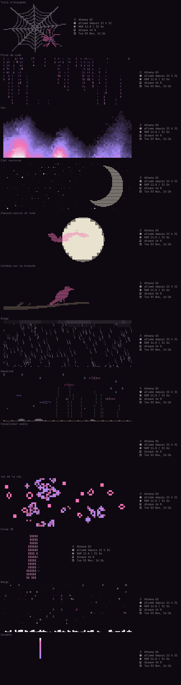

# forsaken-rice

**Français** · [English](README.en.md) · [Русский](README.ru.md) · [Español](README.es.md)

Un bureau Hyprland qui se règle entièrement depuis une appli, **Studio** : couleurs, fenêtres, barre, fond d'écran, écrans, son, clavier, raccourcis, veille, bots… Tout s'applique en direct, et tout le rice est disponible en **français, anglais, russe et espagnol**.



## Ce qu'il y a dedans

- **Studio** (Super+Maj+C) : une appli GTK4 / libadwaita qui génère toute la config à partir d'un seul fichier (`~/.config/studio/studio.json`). 8 thèmes prêts, ou tes couleurs, ou celles du fond d'écran.
- **Nautilus** (Super+E) : le gestionnaire de fichiers GNOME, aux couleurs du thème. Vue, clic, fichiers cachés et tri se règlent dans Studio ; les couleurs suivent le thème automatiquement.
- **Barre waybar** en 6 styles, avec mémoire, processeur, carte graphique, disque, son, réseau, presse-papiers, captures, « ne pas déranger » et bots.
- **Terminal kitty animé** : 13 animations (toile d'araignée, pluie de code, feu, ciel nocturne, chauves-souris, corbeau, orage, aquarium, visualiseur audio, jeu de la vie, logo d'Arch en 3D, neige, serpent), aux couleurs du thème.
  - En boucle dans un panneau en haut, seulement à l'ouverture, en image fixe, ou rien.
  - Mode **aléatoire** : une animation différente à chaque terminal, parmi celles que tu choisis.
  - Réglages propres à chaque animation, plus vitesse, taille, fluidité, et infos système au choix à côté.
- **Prompt starship** sur deux lignes, aux couleurs du thème.
- **Menus wofi** : session, presse-papiers, bots, fermer une appli gourmande.
- **Langue** : un réglage change tous les textes du bureau.

## Installation

Pour Arch Linux et ses dérivées, avec **Hyprland 0.57 ou plus** (configuration en Lua).

```bash
git clone https://github.com/dontleteuwatchyou/forsaken-rice
cd forsaken-rice
./install.sh --lang fr
```

Le script :
1. installe les paquets manquants avec `pacman` (`--no-deps` pour sauter cette étape) ;
2. sauvegarde ta config actuelle dans `~/.local/share/rice-backups/` ;
3. copie Studio, les scripts et les configs, puis génère le thème.

Reconnecte-toi ensuite à Hyprland. Le clavier est en AZERTY par défaut : ça se change dans Studio, onglet « Clavier et souris ».

## Raccourcis principaux

| Touches | Action |
|---|---|
| Super + Entrée | Terminal |
| Super + D | Lanceur d'applis |
| Super + Maj + C | Studio |
| Super + E | Fichiers |
| Super + V | Historique du presse-papiers |
| Super + Maj + S / Impr. écran | Capture d'une zone |
| Super + X | Menu session |
| Super + L | Verrouiller |
| Super + & é " ' ( | Espaces de travail 1 à 5 de l'écran sous la souris |

Tous les raccourcis se modifient dans Studio, onglet « Raccourcis ».

## Où sont les fichiers

| Dans le dépôt | Installé dans | Rôle |
|---|---|---|
| `studio/` | `~/.local/share/studio/` | l'appli Studio, le moteur de thème, les animations, les traductions |
| `bin/` | `~/.local/bin/` | les commandes (`studio`, `studio-apply`, `forsaken-banner`…) |
| `config/hypr/hyprland.lua` | `~/.config/hypr/` | la config Hyprland de base (le reste est généré par Studio) |
| `config/kitty/kitty.conf` | `~/.config/kitty/` | inclut `studio.conf`, généré par Studio |
| `config/starship.toml` | `~/.config/` | le modèle du prompt |
| `config/zsh/zshrc` | `~/.zshrc` | historique, complétion, plugins, prompt, animation |

Pour ajouter une animation : une classe dans `studio/animations.py` (avec sa liste `OPTIONS`). Elle apparaît toute seule dans Studio. Pour ajouter une langue ou un texte : `studio/traductions.py`.
