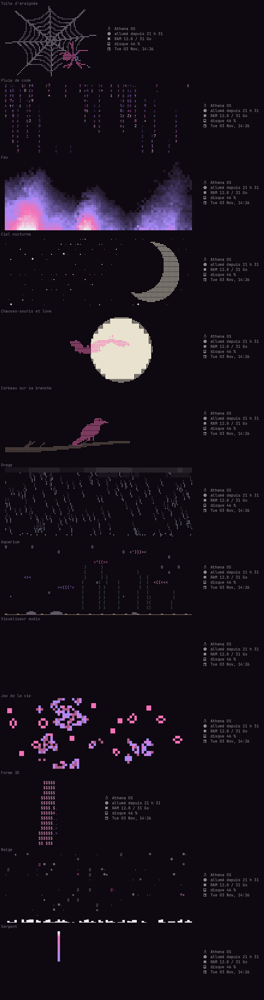

# forsaken-rice

[Français](README.md) · [English](README.en.md) · **Русский** · [Español](README.es.md)

Рабочий стол на Hyprland, который полностью настраивается из одного приложения — **Studio**: цвета, окна, панель, обои, экраны, звук, клавиатура, сочетания клавиш, сон, боты… Всё применяется сразу, а весь райс доступен на **французском, английском, русском и испанском**.



## Что внутри

- **Studio** (Super+Shift+C): приложение на GTK4 / libadwaita, которое создаёт всю конфигурацию из одного файла (`~/.config/studio/studio.json`). 8 готовых тем, свои цвета или цвета, взятые с обоев.
- **Файлы** (Super+E): нативный файловый менеджер на GTK4 в цветах темы. Вид списком или сеткой, боковая панель, копирование/вырезание/вставка, корзина, переименование, свойства, поиск, сжатие и распаковка архивов (zip, tar.gz, tar.xz…). Полное контекстное меню, горячие клавиши, сортировка по имени, размеру, типу или дате.
- **Панель waybar** в 6 стилях: память, процессор, видеокарта, диск, звук, сеть, буфер обмена, снимки экрана, «не беспокоить» и боты.
- **Анимированный терминал kitty**: 13 анимаций (паутина, дождь из кода, огонь, ночное небо, летучие мыши, ворон, гроза, аквариум, аудиовизуализатор, игра «Жизнь», 3D-логотип Arch, снег, змейка) в цветах темы.
  - По кругу в панели сверху, только при запуске, неподвижной картинкой или выключено.
  - **Случайный** режим: в каждом терминале своя анимация из выбранных тобой.
  - Отдельные настройки для каждой анимации, а также скорость, размер, плавность и сведения о системе рядом — на твой выбор.
- **Приглашение starship** в две строки, в цветах темы.
- **Меню wofi**: сеанс, буфер обмена, боты, закрыть прожорливое приложение.
- **Язык**: одна настройка меняет все тексты рабочего стола.

## Установка

Для Arch Linux и производных, с **Hyprland 0.57 или новее** (конфигурация на Lua).

```bash
git clone https://github.com/dontleteuwatchyou/forsaken-rice
cd forsaken-rice
./install.sh --lang ru
```

Скрипт:
1. ставит недостающие пакеты через `pacman` (`--no-deps` пропускает этот шаг);
2. сохраняет твою текущую конфигурацию в `~/.local/share/rice-backups/`;
3. копирует Studio, скрипты и конфиги, затем создаёт тему.

После этого перезайди в Hyprland. По умолчанию раскладка AZERTY: поменять её можно в Studio, вкладка «Клавиатура и мышь».

## Основные сочетания клавиш

| Клавиши | Действие |
|---|---|
| Super + Enter | Терминал |
| Super + D | Запуск приложений |
| Super + Shift + C | Studio |
| Super + E | Файлы |
| Super + V | История буфера обмена |
| Super + Shift + S / Print Screen | Снимок области |
| Super + X | Меню сеанса |
| Super + L | Заблокировать |
| Super + клавиши верхнего ряда 1–5 | Рабочие столы 1–5 экрана под мышью |

Все сочетания меняются в Studio, вкладка «Сочетания клавиш».

## Где лежат файлы

| В репозитории | Куда ставится | Что это |
|---|---|---|
| `studio/` | `~/.local/share/studio/` | приложение Studio, файловый менеджер, движок тем, анимации, переводы |
| `bin/` | `~/.local/bin/` | команды (`studio`, `studio-fichiers`, `studio-apply`, `forsaken-banner`…) |
| `desktop/` | `~/.local/share/applications/` | файлы `.desktop` (Файлы появляются в лаунчерах) |
| `config/hypr/hyprland.lua` | `~/.config/hypr/` | базовая конфигурация Hyprland (остальное создаёт Studio) |
| `config/kitty/kitty.conf` | `~/.config/kitty/` | подключает `studio.conf`, созданный Studio |
| `config/starship.toml` | `~/.config/` | шаблон приглашения |
| `config/zsh/zshrc` | `~/.zshrc` | история, автодополнение, плагины, приглашение, анимация |

Чтобы добавить анимацию: класс в `studio/animations.py` (со списком `OPTIONS`). Она сама появится в Studio. Чтобы добавить язык или текст: `studio/traductions.py`. Чтобы добавить формат архива: константа `ARCHIVE_EXT` в `studio/fichiers.py`.
